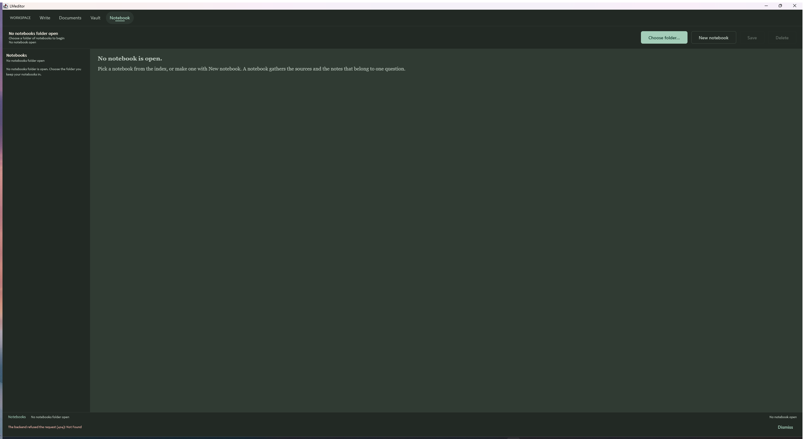

# Notebook workspace blueprint

The active client is Kotlin Compose (`kotlin/desktop`), with immutable controller
state and separately owned transport, model and rendering. Preserve those
boundaries.

## Why this exists

The application is to replace Microsoft Office, Obsidian and Open Notebook. The
first two are done: the window writes Word documents, and it reads and writes a
folder of markdown notes.

This wave covers the third: **Open Notebook** — the open-source, local-first
application whose model is a **notebook**: a named collection of **sources**,
its **notes**, and a conversation with the machine over what they hold.

Its heart is **Ask**: one question, answered from the sources at hand, with the
passages the answer came from cited beside it. That is the capability that
makes it a notebook and not a folder — and LMeditor already has the hard half
of it. The backend ingests sources, indexes their passages, ranks them against
a query (`ProvenanceIndex.query`), writes grounded prose with DSPy, and verifies
what it wrote against the passages it claims to have used. What it does not
have is the thing that joins them: a **notebook**, and an **Ask** that answers
from one.

So this wave adds the notebook and the Ask, and puts them in the window.

## The concept

| Concept | What it is |
| --- | --- |
| **Notebook** | A named collection: a title, a description, the sources it holds, the notes it holds, and when it was last changed. |
| **Source** | A document already ingested by the backend. A notebook points at sources; a source may be in several notebooks. |
| **Note** | A markdown note. The vault holds them; a notebook refers to them by their note id. |
| **Ask** | One question over a notebook, answered from its sources, with the passages cited. |
| **Citation** | A passage the answer leaned on: its chunk id, the source it came from, the source's title, and the passage's own words. |

## The rules

### The notebook store

A notebook is kept on disk the way a book is: a directory under the library
root, with a manifest that indexes it. Those rules — the shape of every file,
the counts, the ordering, the identifiers that are safe to write — are the
Kotlin tier's, exactly as `kotlin/library` owns them for a book. The Python
side keeps a door over the NDJSON seam.

- A notebook's id is safe to write: not blank, not `.` or `..`, no path
  separator, no control character, no character a Windows path forbids.
- Writing a notebook is idempotent: creating a notebook that already exists
  returns it unchanged, and adding a source it already holds changes nothing.
- A notebook may name a source it does not hold, and a note it does not hold;
  the store refuses to delete a source or a note that is not there.
- Removing a source from a notebook does not remove the source from the
  library: the source is the operator's, and the notebook only points at it.
- A request that names no id gets one derived from the title, so the same
  title always yields the same notebook.


### The Ask

- The question is answered **only** from the notebook's sources. A passage that
  is not in the notebook is not a passage the answer may lean on, however
  relevant it looks.
- The passages are ranked with the retrieval the backend already has, and the
  top of that ranking is what the answer is written from.
- Every citation names a passage the answer actually used, and quotes it. A
  citation that points at a passage the answer did not use is a lie.
- When the sources do not answer the question, the answer says so. The machine
  is not allowed to make something up to fill the shape of an answer.
- The answer is a **grounded** answer: it goes through the same verification
  the studio's drafts go through, and a claim the verifier cannot support is
  not reported as supported.

## Where the rules live

| Piece | Where | Why |
| --- | --- | --- |
| The notebook store | A new tier module `:notebooks`, mirroring `kotlin/library`. | The on-disk rules are the tier's, as a book's are. |
| The ranking of passages | The tier's `text` module, through `ProvenanceIndex.query`. | It is already there, and it is already tested against the Python side. |
| The writing of the answer | `lmeditor/drafting`, as a new DSPy module. | Grounded writing is DSPy's job here, and it is already DSPy's job. |
| The citations | `lmeditor/notebooks`, assembled from the passages the answer used. | A citation is a claim about what the machine did, so it is checked, not assumed. |

## The HTTP surface

| Method | Route | Body | Answer |
| --- | --- | --- | --- |
| `POST` | `/api/v1/notebooks/open` | `{"root"}` | `{"root", "name", "notebook_count"}` |
| `GET` | `/api/v1/notebooks` | — | `{"root", "name", "notebook_count", "notebooks": [...]}` |
| `POST` | `/api/v1/notebooks` | `{"title", "description", "notebook_id"?}` | `{"notebook": {...}}` |
| `GET` | `/api/v1/notebooks/{notebook_id}` | — | `{"notebook": {...}}` |
| `PUT` | `/api/v1/notebooks/{notebook_id}` | `{"title", "description"}` | `{"notebook": {...}}` |
| `DELETE` | `/api/v1/notebooks/{notebook_id}` | — | `{"deleted": true}` |
| `POST` | `/api/v1/notebooks/{notebook_id}/sources` | `{"source_id"}` | `{"notebook": {...}}` |
| `DELETE` | `/api/v1/notebooks/{notebook_id}/sources?source_id=…` | — | `{"notebook": {...}}` |
| `POST` | `/api/v1/notebooks/{notebook_id}/notes` | `{"note_id"}` | `{"notebook": {...}}` |
| `DELETE` | `/api/v1/notebooks/{notebook_id}/notes?note_id=…` | — | `{"notebook": {...}}` |
| `POST` | `/api/v1/notebooks/{notebook_id}/ask` | `{"question"}` | `{"answer", "answered", "citations": [...]}` |

`{notebook_id}` is a path segment, because a notebook id is by rule a single
safe path segment. A **source id** and a **note id** travel in the query or the
body, never in the path: a note id is a relative path with `/` separators, and
a `%2F` in a route breaks FastAPI's routing. This is the same rule the vault
already follows, and it is why the two `DELETE` routes above carry their id in
the query.

### The wire shapes

A notebook, as the tier writes it and the client reads it:

```json
{
  "notebook_id": "my-notebook",
  "title": "My Notebook",
  "description": "What it is for.",
  "source_ids": ["src_1"],
  "note_ids": ["notes/a"],
  "created_at": "2026-10-25T12:00:00Z",
  "modified_at": "2026-10-25T12:00:00Z"
}
```

Its summary — what a list carries — is the same shape with the two id lists
replaced by their counts:

```json
{
  "notebook_id": "my-notebook",
  "title": "My Notebook",
  "description": "What it is for.",
  "source_count": 1,
  "note_count": 1,
  "modified_at": "2026-10-25T12:00:00Z"
}
```

`POST …/ask` answers with

```json
{
  "answer": "the grounded answer",
  "citations": [
    {"chunk_id": "chunk_1", "source_id": "src_1", "title": "A Paper",
     "quote": "the passage the answer leaned on"}
  ],
  "answered": true
}
```

`answered` is **false** when the sources could not answer the question. An
answer that says so is a successful ask; an answer that invents one is not.

### The status codes

| Code | When |
| --- | --- |
| `400` | The request itself is wrong: an empty title, an empty question, a notebook id that is not a safe path segment, a source or a note the notebook does not hold. |
| `404` | The notebook is not there. |
| `422` | The body is malformed (FastAPI's own validation). |
| `502` | The Kotlin tier could not be reached, or refused in a way that is not a domain refusal. |

There is no `409`: the notebooks root always exists. It defaults to
`<user home>/.lmeditor/notebooks` and `LMEDITOR_NOTEBOOKS_DIR` overrides it —
the same shape as `LMEDITOR_LIBRARY_DIR`, so a test can redirect it without
touching the real folder. `POST /api/v1/notebooks/open` points it somewhere
else: an absolute path to a folder that is already there.


### The seam

The tier's methods, and their answers:

| Method | Parameters | Answer |
| --- | --- | --- |
| `notebooks.list` | `root` | `{"notebooks": [...]}` |
| `notebooks.read` | `root`, `notebook_id` | `{"notebook": {...}}` |
| `notebooks.create` | `root`, `notebook_id` (optional), `title`, `description` | `{"notebook": {...}}` |
| `notebooks.set_metadata` | `root`, `notebook_id`, `title`, `description` | `{"notebook": {...}}` |
| `notebooks.add_source` | `root`, `notebook_id`, `source_id` | `{"notebook": {...}}` |
| `notebooks.remove_source` | `root`, `notebook_id`, `source_id` | `{"notebook": {...}}` |
| `notebooks.add_note` | `root`, `notebook_id`, `note_id` | `{"notebook": {...}}` |
| `notebooks.remove_note` | `root`, `notebook_id`, `note_id` | `{"notebook": {...}}` |
| `notebooks.delete` | `root`, `notebook_id` | `{"deleted": true}` |

### The on-disk shape

The tier's, and only the tier's:

```
<root>/<notebook_id>/manifest.json
```

```json
{
  "notebook_id": "my-notebook",
  "title": "My Notebook",
  "description": "What it is for.",
  "source_ids": ["src_1"],
  "note_ids": ["notes/a"],
  "created_at": "2026-10-25T12:00:00Z",
  "modified_at": "2026-10-25T12:00:00Z"
}
```

### The Ask, exactly

1. The question is answered **only** from the notebook's sources. A passage
   that is not in the notebook is not a passage the answer may lean on,
   however relevant it looks.
2. The passages are ranked with the retrieval the backend already has
   (`build_provenance_index(chunks).query(question, top_k = 5)`), and the top of
   that ranking is what the answer is written from.
3. The answer is written by a DSPy module whose passage field is named
   `assigned_chunks_text` — the same field name the offline stub reads, so the
   whole thing is provable with no provider.
4. Every citation names a passage the answer actually used, and quotes it. A
   citation that points at a passage the answer did not use is a lie: a chunk
   id that is not among the notebook's retrieved passages is dropped, never
   reported.
5. A citation is *supported* when the answer's own claims that carry it are
   supported by that passage, under the lineage rule the tier already owns. A
   claim the tier cannot support leaves the citation unsupported, and an
   unsupported citation is not reported as supported.
6. `answered` is true when at least one supported citation survives and the
   answer is not empty. When the sources cannot answer the question, the answer
   says so and `answered` is false.


## The workspace

The window gains a **Notebook** workspace beside **Write**, **Documents** and
**Vault**:

- the notebooks the server holds, and the one that is open;
- the sources the open notebook holds, and the notes it refers to;
- a question box, and **Ask**;
- the answer, with its citations beneath it — each one naming the source it
  came from and quoting the passage.

The citation is clickable: it opens the passage in the source pane of the
studio, so the operator can read the evidence rather than trust it.

## Acceptance

- A notebook can be created, renamed, filled with sources and notes, and
  deleted, and the operator can see it in the window.
- **Ask** answers a question from the notebook's sources and cites the
  passages it used.
- A question the sources cannot answer comes back as `answered: false` with an
  answer that says so.
- A source that is not in the notebook is never cited.
- The offline stub model answers, so the whole thing is provable without a
  provider.
- The tier module has an empty runtime dependency set.
- The whole build passes offline and every existing test still passes.

## Result

_Delivered and verified._

The Open Notebook half is built, integrated and proved. A notebook is a
folder on the operator's disk holding one directory per notebook, each with a
manifest; the **ask** answers a question from that notebook's own sources and
cites the passages it leaned on; and the window carries a fourth workspace
for it.



### What was built

- **The tier** — a new module `:notebooks` with an **empty runtime
  dependency set**: the id rule, the derivation of an id from a title, the
  manifest and the store, plus nine `notebooks.*` methods on the NDJSON seam.
  35 new Kotlin tests.
- **The server** — the Python door over the seam, the models that mirror the
  Kotlin vocabulary key for key, the one notebooks folder the server holds,
  and eleven routes under `/api/v1/notebooks`.
- **The ask** — retrieval over the notebook's own sources, a DSPy module
  whose passage field is named `assigned_chunks_text` so the offline stub can
  answer it, the citations read with the tier's own citation grammar, and the
  grounding check that asks the tier whether the answer's claims are supported
  by the passage they cite.
- **The workspace** — a fourth tab on the rail, the notebook index, the open
  notebook's sources and notes, the ask, and the citations that quote their
  passage and open it in the studio.

### Observed verification

- Offline `kotlin/` build: **977 tests, zero failures, zero errors, zero
  skipped** across the fifteen tier modules and the desktop client, up from
  914. The new `:notebooks` module holds 35 of them and the desktop client
  is at 101, up from 86.
- Backend suite: **1361 passed**, up from 1341.
- The parity harness: **22 agreed, 0 disagreed, 0 skipped**. The notebook's
  rules are not among them: they are new rules, not a port of a Python one,
  and they have no Python ancestor to be compared with.
- `backend/tests/test_kotlin_dependencies.py` discovers the tier's modules
  from the Gradle build, so `:notebooks` was covered without being named:
  **18 passed**, and the module's runtime dependency set is empty.
- Live round trip against a running backend, through the real HTTP surface:
  **every check passed**. The notebook is a directory with a manifest on the
  operator's disk; the title, the sources and the notes follow it; a source
  the notebook does not hold cannot be removed; the ask is answered from the
  notebook's **own** sources with the passage quoted; a source outside the
  notebook is **never** cited; a notebook with no sources says it cannot
  answer; an unsafe notebook id is refused; and the sources outlive the
  notebook that pointed at them.
- The desktop window was launched with the fourth workspace on its rail, and
  the workspace opened without error.

